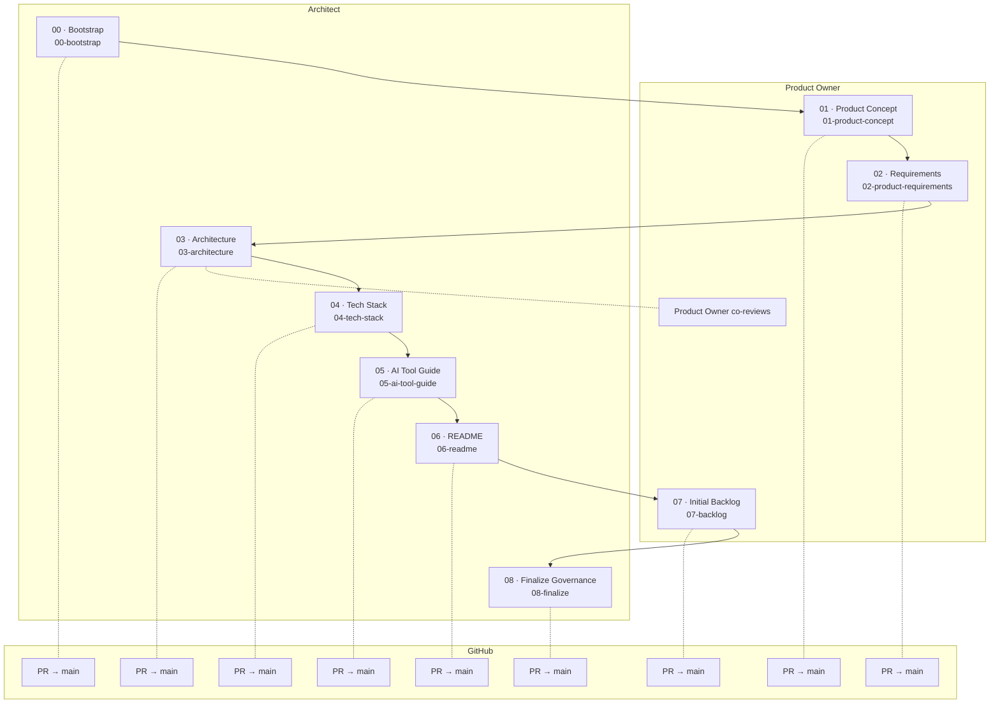
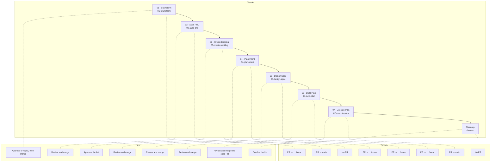
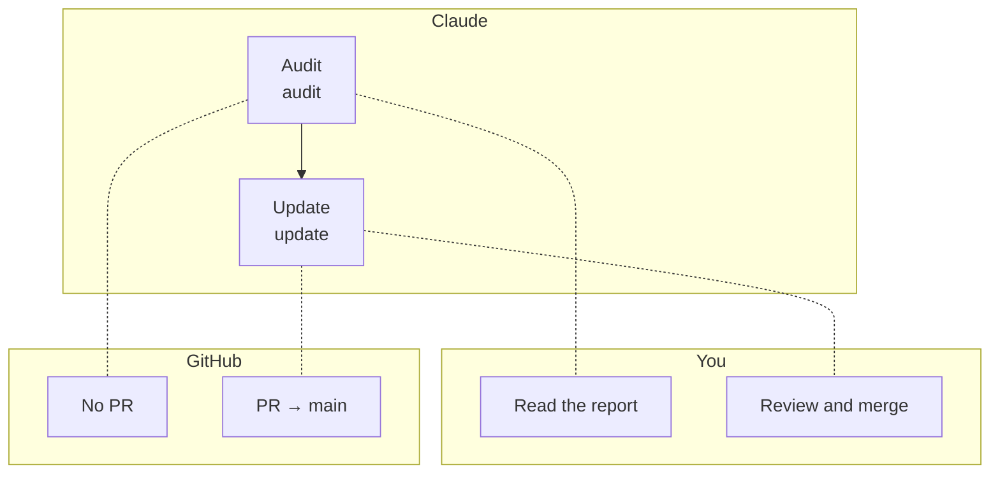

# Cuevik Plugins — Walkthrough

**Plugins:** cuevik-start 0.1, cuevik-ship 0.1, cuevik-docs 0.1  ·  **Marketplace:** cuevik-plugins  ·  **Author:** Viral Parikh

Draft. Sections 1–5 hold the diagrams and reference tables, which are generated from the plugins or checked against them. The step-by-step prose is written next.

---

## 1. The three plugins

| Plugin | Use it to | Commands |
|---|---|---|
| `cuevik-start` | Start a project the governed way | `00`–`08`, `status`, `cleanup` |
| `cuevik-ship` | Deliver one issue at a time, from idea to code PR | `01`–`07`, `cleanup` |
| `cuevik-docs` | Audit and update source-of-truth documents | `audit`, `update` |

---

## 2. The flow by actor

Who acts at each step, one diagram per plugin. They are also the three pages of `Cuevik-Plugins_WalkthroughByActor.pdf`.

### cuevik-start

Lanes are the document owners from the project's lineage. Every command is `/cuevik-start:<name>`.

<!-- gen:flow-start -->

<!-- /gen:flow-start -->

### cuevik-ship

You approve and merge, Claude runs each command in its own session, and GitHub holds the issue, branches and PRs. Every command is `/cuevik-ship:<name>`.

<!-- gen:flow-ship -->

<!-- /gen:flow-ship -->

### cuevik-docs

Same lanes as `cuevik-ship`. Every command is `/cuevik-docs:<name>`.

<!-- gen:flow-docs -->

<!-- /gen:flow-docs -->

---

## 3. cuevik-start steps

Each step runs in its own session on branch `init/<name>` and ends in a PR to `main`. Every command is `/cuevik-start:<name>`. Owner, reviewers and the documents a step reads come from the lineage; the outputs come from the step registry.

<!-- gen:start-steps -->

| Command | Owner | Reviewers | Reads | Writes |
|---|---|---|---|---|
| `00-bootstrap` | Architect | Architect | `docs/TECH-STACK.md` | `CONTRIBUTING.md`, `.cuevik/config.json`, `.cuevik/lineage.json`, `.markdownlint.json` |
| `01-product-concept` | Product Owner | Product Owner | — | `docs/PRODUCT.md` |
| `02-product-requirements` | Product Owner | Product Owner | `docs/PRODUCT.md` | `docs/PRD.md` |
| `03-architecture` | Architect | Architect, Product Owner | `docs/PRD.md` | `docs/ARCHITECTURE.md` |
| `04-tech-stack` | Architect | Architect | `docs/PRD.md`, `docs/ARCHITECTURE.md` | `docs/TECH-STACK.md`, `CONTRIBUTING.md` |
| `05-ai-tool-guide` | Architect | Architect | `docs/ARCHITECTURE.md`, `docs/TECH-STACK.md` | `docs/AI-TOOL-GUIDE.md`, `CLAUDE.md`, `.github/copilot-instructions.md` |
| `06-readme` | Architect | Architect | `docs/PRODUCT.md`, `docs/PRD.md`, `docs/ARCHITECTURE.md`, `docs/TECH-STACK.md`, `docs/AI-TOOL-GUIDE.md` | `README.md` |
| `07-backlog` | Product Owner | Product Owner | `docs/PRODUCT.md`, `docs/PRD.md`, `docs/ARCHITECTURE.md`, `docs/TECH-STACK.md`, `docs/AI-TOOL-GUIDE.md`, `README.md` | `docs/BACKLOG.md` |
| `08-finalize` | Architect | Architect | `docs/TECH-STACK.md` | `CONTRIBUTING.md` |

<!-- /gen:start-steps -->

---

## 4. Command reference

### What each command does

| Command | Title | What it does |
|---|---|---|
| `/cuevik-start:00-bootstrap` | Bootstrap | Connects or creates the GitHub repo and project board, then lands the governance baseline in a reviewed PR. |
| `/cuevik-start:01-product-concept` | Product Concept | Drafts the product concept with you: what it is, who it is for and why it exists. |
| `/cuevik-start:02-product-requirements` | Requirements | Turns the concept into numbered, testable requirements (the PRD). |
| `/cuevik-start:03-architecture` | Architecture | Designs the system: components, data, integrations and the decisions behind them. |
| `/cuevik-start:04-tech-stack` | Tech Stack | Locks the approved technologies and the build, test and lint commands. |
| `/cuevik-start:05-ai-tool-guide` | AI Tool Guide | Sets the rules for AI coding assistants and generates the files each one reads. |
| `/cuevik-start:06-readme` | README | Replaces the boilerplate README with the project's real entry point. |
| `/cuevik-start:07-backlog` | Initial Backlog | Derives epics and stories from the product docs and files them as GitHub issues. |
| `/cuevik-start:08-finalize` | Finalize Governance | Removes the initiation-only rules from CONTRIBUTING.md and hands over the permanent ones. |
| `/cuevik-start:status` | Status | Shows how far initiation has got, from what is merged on GitHub. Read-only. |
| `/cuevik-start:cleanup` | Clean up | Deletes local `init/*` branches whose PR is merged, after listing them for your confirmation. |
| `/cuevik-ship:01-brainstorm` | Brainstorm | Takes an idea or an existing issue, checks it is not a duplicate, and explores it until you can approve or reject it. |
| `/cuevik-ship:02-audit-prd` | Audit PRD | Checks the approved idea against the product docs and ratifies it into new or changed requirements. |
| `/cuevik-ship:03-create-backlog` | Create Backlog | Files the requirements as an epic and stories on GitHub, splitting the idea when it covers several. |
| `/cuevik-ship:04-plan-intent` | Plan Intent | States the problem and scope, before any solution, in the issue's own work folder. |
| `/cuevik-ship:05-design-spec` | Design Spec | Writes the spec: behaviour, data, rules and tests. |
| `/cuevik-ship:06-build-plan` | Build Plan | Turns the spec into a dependency-ordered task list that a fresh session can execute. |
| `/cuevik-ship:07-execute-plan` | Execute Plan | Builds the plan on a code branch and opens the code PR to `main`. |
| `/cuevik-ship:cleanup` | Clean up | Removes the issue's worktree and local branches and archives the remote branch as a tag, after listing them for your confirmation. |
| `/cuevik-docs:audit` | Audit | Reads your docs once and reports gaps (Align), contradictions (Drift) and duplication (Absorb). |
| `/cuevik-docs:update` | Update | Updates one source-of-truth document through a reviewed PR, using its owner and reviewers from the lineage, and flags downstream documents. |

### Branches and files (ship, docs and utility commands)

The nine numbered `cuevik-start` steps are not repeated here: their branch and outputs are in section 3. In `cuevik-ship`, `<n>` is the issue number and `<slug>` its short name.

| Command | Branch | PR to | Writes | You |
|---|---|---|---|---|
| `/cuevik-start:status` | — | — | Nothing (report only) | Read the report |
| `/cuevik-start:cleanup` | — | — | Deletes merged local `init/*` branches | Confirm the list |
| `/cuevik-ship:01-brainstorm` | `ship/<n>-<slug>/01-brainstorm` | `ship/<n>-<slug>/issue` | GitHub issue and brainstorming folder | Approve or reject, then merge |
| `/cuevik-ship:02-audit-prd` | `ship/<n>-<slug>/02-audit-prd` (cut from `main`) | `main` | `PRODUCT.md` and `PRD.md` changes | Review and merge |
| `/cuevik-ship:03-create-backlog` | — | — | GitHub issues: epic and stories | Approve the list |
| `/cuevik-ship:04-plan-intent` | `ship/<n>-<slug>/04-plan-intent` | `ship/<n>-<slug>/issue` | `intent.md` in the work folder | Review and merge |
| `/cuevik-ship:05-design-spec` | `ship/<n>-<slug>/05-design-spec` | `ship/<n>-<slug>/issue` | `spec.md` in the work folder | Review and merge |
| `/cuevik-ship:06-build-plan` | `ship/<n>-<slug>/06-build-plan` | `ship/<n>-<slug>/issue` | `plan.md` in the work folder | Review and merge |
| `/cuevik-ship:07-execute-plan` | `ship/<n>-<slug>/07-execute-plan` (cut from `main`) | `main` | The code | Review and merge the code PR |
| `/cuevik-ship:cleanup` | — | — | Worktree, local branches, archive tag | Confirm the list |
| `/cuevik-docs:audit` | — | — | Nothing (report only) | Read the report |
| `/cuevik-docs:update` | `docs/update/<doc>` | `main` | The document, via PR | Review and merge |

---

## 5. Who owns which document

From the default lineage: who owns each document, who reviews a change to it, and what it is built from.

<!-- gen:doc-owners -->

| Document | Owner | Reviewers | Built from |
|---|---|---|---|
| `CONTRIBUTING.md` | Architect | Architect | `docs/TECH-STACK.md` |
| `docs/PRODUCT.md` | Product Owner | Product Owner | — |
| `docs/PRD.md` | Product Owner | Product Owner | `docs/PRODUCT.md` |
| `docs/ARCHITECTURE.md` | Architect | Architect, Product Owner | `docs/PRD.md` |
| `docs/TECH-STACK.md` | Architect | Architect | `docs/PRD.md`, `docs/ARCHITECTURE.md` |
| `docs/AI-TOOL-GUIDE.md` | Architect | Architect | `docs/ARCHITECTURE.md`, `docs/TECH-STACK.md` |
| `README.md` | Architect | Architect | `docs/PRODUCT.md`, `docs/PRD.md`, `docs/ARCHITECTURE.md`, `docs/TECH-STACK.md`, `docs/AI-TOOL-GUIDE.md` |
| `docs/BACKLOG.md` | Product Owner | Product Owner | `docs/PRODUCT.md`, `docs/PRD.md`, `docs/ARCHITECTURE.md`, `docs/TECH-STACK.md`, `docs/AI-TOOL-GUIDE.md`, `README.md` |

<!-- /gen:doc-owners -->
