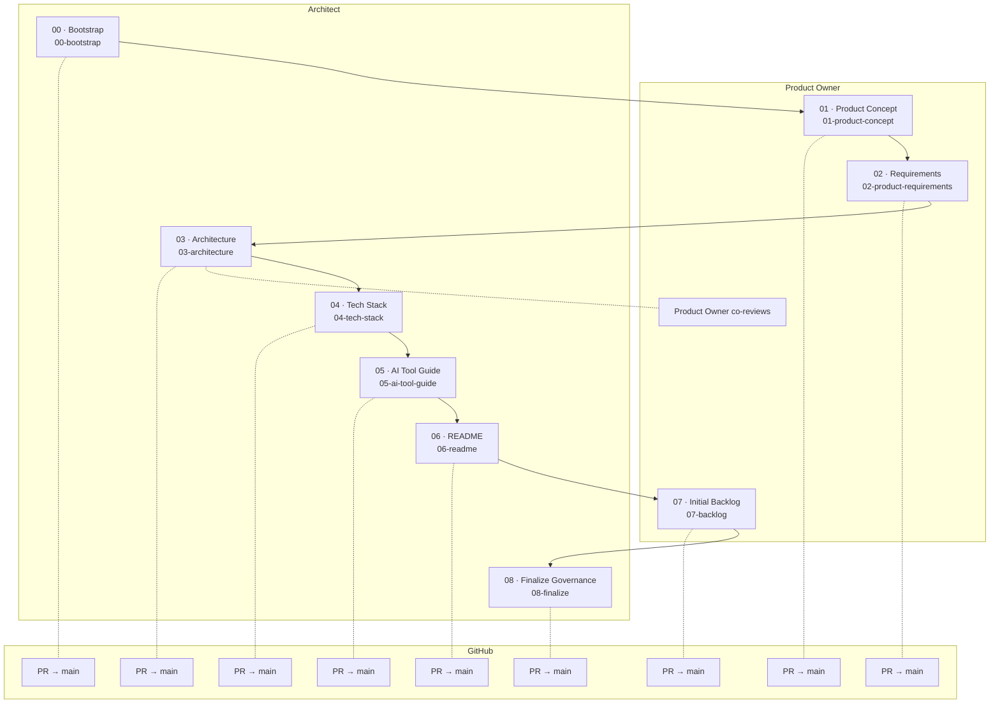
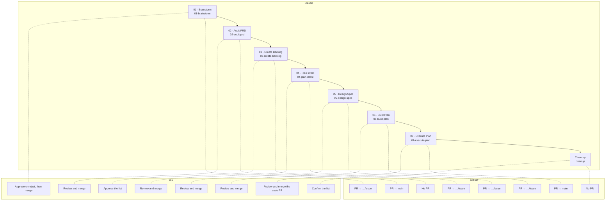
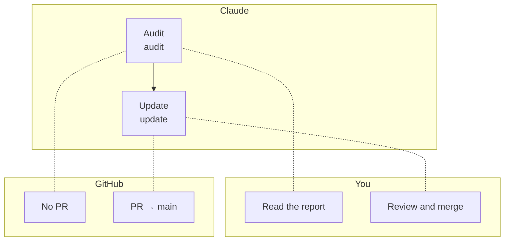

# Cuevik Plugins — Walkthrough

**Plugins:** cuevik-start 0.1, cuevik-ship 0.1, cuevik-docs 0.1  ·  **Marketplace:** cuevik-plugins  ·  **Author:** Viral Parikh

Claude drafts each step, you approve it. This guide covers all three plugins: how to install them, how every step works, and what each command does, from an empty repo to a merged code PR.

---

## 1. What you get

Three plugins with one rule: every document and change reaches `main` through a reviewed PR, and the next step will not run until the previous PR is merged.

| Plugin | Use it to | Commands |
|---|---|---|
| `cuevik-start` | Start a project the governed way | `00`–`08`, `status`, `cleanup` |
| `cuevik-ship` | Deliver one issue at a time, from idea to code PR | `01`–`07`, `cleanup` |
| `cuevik-docs` | Audit and update source-of-truth documents | `audit`, `update` |

---

## 2. Install and prerequisites

Before you install:

- [GitHub CLI](https://cli.github.com) (`gh`), signed in with the `project` scope: `gh auth login`, then `gh auth refresh -s project`.
- A local Claude Code session. Cloud sessions cannot reach GitHub Projects.
- Read access to the marketplace repository, which is private for now.
- Admin rights on the project's repo. `00-bootstrap` changes a repo setting and links a board.
- GitHub as your host. It is the only one supported.

Install, in Claude Code:

```text
/plugin marketplace add viralparikh-dev/cuevik-plugins
/plugin install cuevik-start@cuevik-plugins
/plugin install cuevik-ship@cuevik-plugins
```

`cuevik-docs` installs automatically: both other plugins depend on it.

Run commands in your project folder (the repo root), in a new Claude Code session. Steps run only when you type them; Claude never starts one on its own.

---

## 3. How it works

- **One step, one session.** Run one step per session. Ask for a second step in the same session and it tells you to start a new one.
- **One PR per step.** A step works on its own branch (`init/<name>` in `cuevik-start`), commits there, and opens a PR to `main` once you approve. It never commits to `main`.
- **Merged means final.** A document counts only when its PR is merged. The next step refuses to run until the previous PR is merged. An open PR does not count.
- **Nothing happens without a yes.** Before it creates a branch, writes files, files issues or pushes, a step shows a checklist of what it verified and waits for your explicit `yes`.
- **One question at a time, fixed structure.** Claude interviews you for each section, never assumes an answer, and fills a template, so every project gets the same sections in the same order, with no placeholders left.
- **Owners and reviewers.** Every document has an owner role and reviewer roles. Claude acts as the owner while it drafts, and each reviewer applies their own checklist at PR review. These are roles, not GitHub accounts.
- **Solo is fine.** GitHub does not let you approve your own PR, so when one person holds every role, the self-review checklist in `CONTRIBUTING.md` is the approval. Wait a few hours (ideally a day), check every required section is covered and no upstream document changed on `main`, then merge. Change hats on purpose.
- **Finished means finished.** Re-running a finished step stops and sends you to `/cuevik-docs:update <document>`.

### What happens inside a step

1. You start the command in a fresh session, in the project folder.
2. It checks the ground: clean working tree, `main` up to date, the previous step's PR merged, upstream documents on `main`, and this step's output not already final.
3. It shows the checklist, waits for your `yes`, then creates the step's branch from `main`.
4. It interviews you, drafts, and revises until you approve, then commits on the branch.
5. On your approval it pushes and opens the PR, with a summary and the reviewer checklist.
6. You review and merge on GitHub, then start the next step in a new session.

### What lands in your repo

Two small files describe the project to the plugins; `00-bootstrap` writes and commits both. `.cuevik/config.json` holds the project board's ids, so steps can add issues and move cards. `.cuevik/lineage.json` holds who owns and reviews each document and what it is built from. Everything else is your documents: the plugins never copy their own files into your repo.

---

## 4. The flow by actor

Who acts at each step, one diagram per plugin. They are also the three pages of `Cuevik-Plugins_WalkthroughByActor.pdf`.

### cuevik-start

Lanes are the document owners from the project's lineage. Every command is `/cuevik-start:<name>`.

<!-- gen:flow-start -->



<!-- /gen:flow-start -->

### cuevik-ship

You approve and merge, Claude runs each command in its own session, and GitHub holds the issue, branches and PRs. Every command is `/cuevik-ship:<name>`.

<!-- gen:flow-ship -->



<!-- /gen:flow-ship -->

### cuevik-docs

Same lanes as `cuevik-ship`. Every command is `/cuevik-docs:<name>`.

<!-- gen:flow-docs -->



<!-- /gen:flow-docs -->

---

## 5. cuevik-start: set up a project

Nine steps, run in order, one session and one PR each. Each step reads the documents before it from `main`, so the order matters. Every command is `/cuevik-start:<name>` and runs on branch `init/<name>`. The line under each heading is generated from the plugin's own step registry and lineage.

### 00-bootstrap

<!-- gen:step-00-bootstrap -->

**Owner:** Architect  ·  **Reviewers:** Architect  ·  **Reads:** —  ·  **Writes:** `CONTRIBUTING.md`, `.cuevik/config.json`, `.cuevik/lineage.json`, `.markdownlint.json`  ·  **Then:** `/cuevik-start:01-product-concept`

<!-- /gen:step-00-bootstrap -->

Connects or creates the GitHub repo and project board, then lands the governance baseline. Run it first, in the project folder. It is the only step that creates things outside your repo, so it lists every change and waits for a separate `yes` on each.

- **Repo.** Connects the folder to a GitHub repo, or creates one. It asks for the owner and name, and for the visibility of a new repo (private is suggested). In an empty folder it clones an existing repo. It stops if the folder has files but no repo (it never commits your files for you), if the folder sits inside another repo, or if `origin` is not on GitHub.
- **Board.** Asks who owns the project board (the repo's owner by default), lists that owner's open boards, and lets you pick one or create a new one. A new board is a copy of a template board: you can name one as `<owner>/<number>`, and a default is offered. If no template can be read, you pick an existing board or a blank one, and a blank board gets only GitHub's default Status options (`Todo`, `In Progress`, `Done`). The board needs a single-select field named `Status`.
- **Remote changes.** Each is confirmed on its own: create the board, link it to the repo, and turn on auto-delete for merged PR branches, so GitHub removes each PR's branch when it merges.
- **The PR.** Opens `init/00-bootstrap` with `CONTRIBUTING.md`, `.cuevik/config.json`, `.cuevik/lineage.json` and `.markdownlint.json`. An existing `.markdownlint.json` is kept. An existing `CONTRIBUTING.md` keeps its text: the governance text is inserted after its first heading and you see the diff first. If the repo has no commit yet, it first makes one empty commit, `chore: initialize repository`, on `main` and pushes it. That is the only commit bootstrap makes on `main`.
- **The governance text** covers the review flow, Conventional Commits and the rule never to push to `main`. It also carries the initiation-only branching table and the self-review checklist, which `08-finalize` removes.
- **It stops, and says what to fix,** if `gh` is not signed in, the default branch is not `main`, you lack admin rights on the repo, the repo is already bootstrapped, or a `00-bootstrap` PR is already open.

Review the PR:

- `CONTRIBUTING.md` holds the governance text verbatim, with both `INITIATION-ONLY` markers. If it already existed, your text is unchanged.
- No stack-specific commands in `CONTRIBUTING.md`.
- `.cuevik/config.json` names the board linked to this repo, with ids read from GitHub.
- `.cuevik/lineage.json` matches the plugin's default lineage.
- Auto-delete is on: `gh repo view --json deleteBranchOnMerge` returns `true`.
- No plugin files (runner, registry, templates, roles) in the diff.

Not yet tested: linking a user-owned board to an organisation-owned repo.

### 01-product-concept

<!-- gen:step-01-product-concept -->

**Owner:** Product Owner  ·  **Reviewers:** Product Owner  ·  **Reads:** —  ·  **Writes:** `docs/PRODUCT.md`  ·  **Then:** `/cuevik-start:02-product-requirements`

<!-- /gen:step-01-product-concept -->

Defines what the product is, who it is for and why it exists. Claude interviews you as the Product Owner and pushes back: every feature must answer *what user problem does this solve?*, and nothing technical belongs here. The result is `docs/PRODUCT.md` with six sections: Overview, Target Users, Features, Scope (In / Out), Success Criteria, Anti-Patterns.

### 02-product-requirements

<!-- gen:step-02-product-requirements -->

**Owner:** Product Owner  ·  **Reviewers:** Product Owner  ·  **Reads:** `docs/PRODUCT.md`  ·  **Writes:** `docs/PRD.md`  ·  **Then:** `/cuevik-start:03-architecture`

<!-- /gen:step-02-product-requirements -->

Turns the concept into numbered, testable requirements. The result is `docs/PRD.md` with twelve sections: Overview, Target Users, Problem Statements, Features / Capabilities, User Stories, Functional Requirements, Non-Functional Requirements, Acceptance Criteria, Out of Scope (This Release), Dependencies & Assumptions, Constraints (Non-Architectural), Risks & Edge Cases.

The Product Owner blocks the PR if:

- acceptance criteria are vague ("works correctly", "performs well")
- a feature has no user story
- a requirement does not trace back to `docs/PRODUCT.md`
- implementation, architecture or stack details appear
- out-of-scope items are implied instead of listed
- requirements lack unique IDs

### 03-architecture

<!-- gen:step-03-architecture -->

**Owner:** Architect  ·  **Reviewers:** Architect, Product Owner  ·  **Reads:** `docs/PRD.md`  ·  **Writes:** `docs/ARCHITECTURE.md`  ·  **Then:** `/cuevik-start:04-tech-stack`

<!-- /gen:step-03-architecture -->

Designs the system from the requirements. The result is `docs/ARCHITECTURE.md` with eight sections: System Architecture, Data Design, Data Flow & Interactions, Key Design Decisions, Implementation Conventions, Integration Points, Security Posture & Data Classification, Non-Functional Approach.

Every significant decision is written as **Context, Decision, Alternatives rejected, Trade-offs**. The Product Owner co-reviews the scope only. If the architecture contradicts or widens the scope in the PRD, they block the PR with a written scope conflict. Resolving it takes a PRD update through its own PR first, then the architecture is revised.

### 04-tech-stack

<!-- gen:step-04-tech-stack -->

**Owner:** Architect  ·  **Reviewers:** Architect  ·  **Reads:** `docs/PRD.md`, `docs/ARCHITECTURE.md`  ·  **Writes:** `docs/TECH-STACK.md`, `CONTRIBUTING.md`  ·  **Then:** `/cuevik-start:05-ai-tool-guide`

<!-- /gen:step-04-tech-stack -->

Locks the approved technologies and the trade-offs behind them. The result is `docs/TECH-STACK.md` with six sections: Languages & Frameworks, Datastores, Cloud & Infrastructure Services, Key Libraries / Tools, Selection Trade-offs, Versions & Constraints.

It then appends a tooling layer (build, test and lint commands) to `CONTRIBUTING.md`, using only technologies approved in `TECH-STACK.md` and leaving the governance layer from `00-bootstrap` untouched. The Architect blocks the PR if a technology choice has no justification against the alternatives.

### 05-ai-tool-guide

<!-- gen:step-05-ai-tool-guide -->

**Owner:** Architect  ·  **Reviewers:** Architect  ·  **Reads:** `docs/ARCHITECTURE.md`, `docs/TECH-STACK.md`  ·  **Writes:** `docs/AI-TOOL-GUIDE.md`, `CLAUDE.md`, `.github/copilot-instructions.md`  ·  **Then:** `/cuevik-start:06-readme`

<!-- /gen:step-05-ai-tool-guide -->

Sets the rules AI coding assistants follow on this project. It asks which AI tools the team uses, then writes `docs/AI-TOOL-GUIDE.md` and only the adapter files for those tools (`CLAUDE.md`, `.github/copilot-instructions.md`). The shared rules live in the guide; each adapter holds only tool-specific settings.

The guide has ten sections: Project Context, Coding Conventions, Scope Boundaries, Banned Patterns, Testing Rules, Documentation Rules, Decision Escalation, Agent Behavior Rules, Off-Limits Boundaries, Workflow Conventions.

### 06-readme

<!-- gen:step-06-readme -->

**Owner:** Architect  ·  **Reviewers:** Architect  ·  **Reads:** `docs/PRODUCT.md`, `docs/PRD.md`, `docs/ARCHITECTURE.md`, `docs/TECH-STACK.md`, `docs/AI-TOOL-GUIDE.md`  ·  **Writes:** `README.md`  ·  **Then:** `/cuevik-start:07-backlog`

<!-- /gen:step-06-readme -->

Replaces the repo's boilerplate README with the project's real entry point, built from the documents before it: Project Overview, Key Concepts, Prerequisites, Environment Setup, Install & Run, Run Tests, Project Structure, Further Reading. Leftover placeholder text is removed, and every command in the README is run before it is committed.

### 07-backlog

<!-- gen:step-07-backlog -->

**Owner:** Product Owner  ·  **Reviewers:** Product Owner  ·  **Reads:** `docs/PRODUCT.md`, `docs/PRD.md`, `docs/ARCHITECTURE.md`, `docs/TECH-STACK.md`, `docs/AI-TOOL-GUIDE.md`, `README.md`  ·  **Writes:** `docs/BACKLOG.md`  ·  **Then:** `/cuevik-start:08-finalize`

<!-- /gen:step-07-backlog -->

Derives epics and stories from the product concept and the PRD, shows them, and writes nothing until you approve. It then creates the GitHub issues one at a time, labelled `epic`, `story` and `priority:*`, and records the initial backlog in `docs/BACKLOG.md`: Summary, Epics, Stories, Out-of-Scope Notes.

After setup, GitHub is the backlog. `docs/BACKLOG.md` is a snapshot and stays frozen.

### 08-finalize

<!-- gen:step-08-finalize -->

**Owner:** Architect  ·  **Reviewers:** Architect  ·  **Reads:** `docs/TECH-STACK.md`  ·  **Writes:** `CONTRIBUTING.md`  ·  **Then:** `/cuevik-start:cleanup`

<!-- /gen:step-08-finalize -->

Ends initiation. It reads `CONTRIBUTING.md` from `main`, removes the fenced `INITIATION-ONLY` block (the branching table and the self-review checklist), keeps the permanent governance and the tooling layer exactly as they are, and puts a short development-phase stub where the block was. It does not write a full development policy: the team expands the stub later with `/cuevik-docs:update`. If the markers are missing it stops rather than guess which lines to delete.

Initiation is complete when this PR is merged.

### status and cleanup

- `/cuevik-start:status` is read-only. It shows how far setup has got from what is merged on GitHub, and writes nothing. Every step also runs it at the start of its session.
- `/cuevik-start:cleanup` deletes the local `init/*` branches whose PR is merged. It skips and reports any that are not merged, and lists what it will delete and asks first. Run it any time, typically after `08-finalize` merges. GitHub has already deleted the remote branches.

To revise a document after its step is merged, use `/cuevik-docs:update <document>` instead of re-running the step.

---

## 6. Command reference

### What each command does

| Command | Title | What it does |
|---|---|---|
| `/cuevik-start:00-bootstrap` | Bootstrap | Connects or creates the GitHub repo and project board, then lands the governance baseline in a reviewed PR. |
| `/cuevik-start:01-product-concept` | Product Concept | Drafts the product concept with you: what it is, who it is for and why it exists. |
| `/cuevik-start:02-product-requirements` | Requirements | Turns the concept into numbered, testable requirements (the PRD). |
| `/cuevik-start:03-architecture` | Architecture | Designs the system: components, data, integrations and the decisions behind them. |
| `/cuevik-start:04-tech-stack` | Tech Stack | Locks the approved technologies and the build, test and lint commands. |
| `/cuevik-start:05-ai-tool-guide` | AI Tool Guide | Sets the rules for AI coding assistants and generates the files each one reads. |
| `/cuevik-start:06-readme` | README | Replaces the boilerplate README with the project's real entry point. |
| `/cuevik-start:07-backlog` | Initial Backlog | Derives epics and stories from the product docs and files them as GitHub issues. |
| `/cuevik-start:08-finalize` | Finalize Governance | Removes the initiation-only rules from CONTRIBUTING.md and hands over the permanent ones. |
| `/cuevik-start:status` | Status | Shows how far initiation has got, from what is merged on GitHub. Read-only. |
| `/cuevik-start:cleanup` | Clean up | Deletes local `init/*` branches whose PR is merged, after listing them for your confirmation. |
| `/cuevik-ship:01-brainstorm` | Brainstorm | Takes an idea or an existing issue, checks it is not a duplicate, and explores it until you can approve or reject it. |
| `/cuevik-ship:02-audit-prd` | Audit PRD | Checks the approved idea against the product docs and ratifies it into new or changed requirements. |
| `/cuevik-ship:03-create-backlog` | Create Backlog | Files the requirements as an epic and stories on GitHub, splitting the idea when it covers several. |
| `/cuevik-ship:04-plan-intent` | Plan Intent | States the problem and scope, before any solution, in the issue's own work folder. |
| `/cuevik-ship:05-design-spec` | Design Spec | Writes the spec: behaviour, data, rules and tests. |
| `/cuevik-ship:06-build-plan` | Build Plan | Turns the spec into a dependency-ordered task list that a fresh session can execute. |
| `/cuevik-ship:07-execute-plan` | Execute Plan | Builds the plan on a code branch and opens the code PR to `main`. |
| `/cuevik-ship:cleanup` | Clean up | Removes the issue's worktree and local branches and archives the remote branch as a tag, after listing them for your confirmation. |
| `/cuevik-docs:audit` | Audit | Reads your docs once and reports gaps (Align), contradictions (Drift) and duplication (Absorb). |
| `/cuevik-docs:update` | Update | Updates one source-of-truth document through a reviewed PR, using its owner and reviewers from the lineage, and flags downstream documents. |

### Branches and files (ship, docs and utility commands)

The nine numbered `cuevik-start` steps are not repeated here: see section 5. In `cuevik-ship`, `<n>` is the issue number and `<slug>` its short name.

| Command | Branch | PR to | Writes | You |
|---|---|---|---|---|
| `/cuevik-start:status` | — | — | Nothing (report only) | Read the report |
| `/cuevik-start:cleanup` | — | — | Deletes merged local `init/*` branches | Confirm the list |
| `/cuevik-ship:01-brainstorm` | `ship/<n>-<slug>/01-brainstorm` | `ship/<n>-<slug>/issue` | GitHub issue and brainstorming folder | Approve or reject, then merge |
| `/cuevik-ship:02-audit-prd` | `ship/<n>-<slug>/02-audit-prd` (cut from `main`) | `main` | `PRODUCT.md` and `PRD.md` changes | Review and merge |
| `/cuevik-ship:03-create-backlog` | — | — | GitHub issues: epic and stories | Approve the list |
| `/cuevik-ship:04-plan-intent` | `ship/<n>-<slug>/04-plan-intent` | `ship/<n>-<slug>/issue` | `intent.md` in the work folder | Review and merge |
| `/cuevik-ship:05-design-spec` | `ship/<n>-<slug>/05-design-spec` | `ship/<n>-<slug>/issue` | `spec.md` in the work folder | Review and merge |
| `/cuevik-ship:06-build-plan` | `ship/<n>-<slug>/06-build-plan` | `ship/<n>-<slug>/issue` | `plan.md` in the work folder | Review and merge |
| `/cuevik-ship:07-execute-plan` | `ship/<n>-<slug>/07-execute-plan` (cut from `main`) | `main` | The code | Review and merge the code PR |
| `/cuevik-ship:cleanup` | — | — | Worktree, local branches, archive tag | Confirm the list |
| `/cuevik-docs:audit` | — | — | Nothing (report only) | Read the report |
| `/cuevik-docs:update` | `docs/update/<doc>` | `main` | The document, via PR | Review and merge |

---

## 7. Who owns which document

From the default lineage: who owns each document, who reviews a change to it, and what it is built from.

<!-- gen:doc-owners -->

| Document | Owner | Reviewers | Built from |
|---|---|---|---|
| `CONTRIBUTING.md` | Architect | Architect | `docs/TECH-STACK.md` |
| `docs/PRODUCT.md` | Product Owner | Product Owner | — |
| `docs/PRD.md` | Product Owner | Product Owner | `docs/PRODUCT.md` |
| `docs/ARCHITECTURE.md` | Architect | Architect, Product Owner | `docs/PRD.md` |
| `docs/TECH-STACK.md` | Architect | Architect | `docs/PRD.md`, `docs/ARCHITECTURE.md` |
| `docs/AI-TOOL-GUIDE.md` | Architect | Architect | `docs/ARCHITECTURE.md`, `docs/TECH-STACK.md` |
| `README.md` | Architect | Architect | `docs/PRODUCT.md`, `docs/PRD.md`, `docs/ARCHITECTURE.md`, `docs/TECH-STACK.md`, `docs/AI-TOOL-GUIDE.md` |
| `docs/BACKLOG.md` | Product Owner | Product Owner | `docs/PRODUCT.md`, `docs/PRD.md`, `docs/ARCHITECTURE.md`, `docs/TECH-STACK.md`, `docs/AI-TOOL-GUIDE.md`, `README.md` |

<!-- /gen:doc-owners -->
