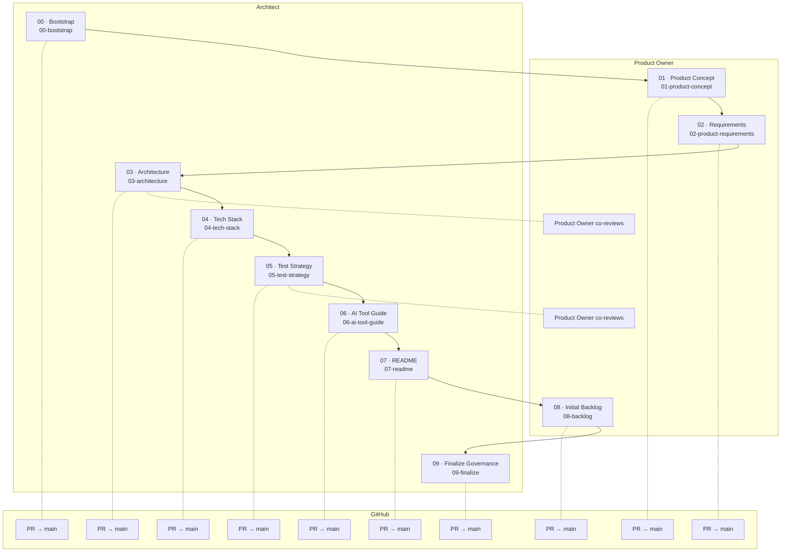
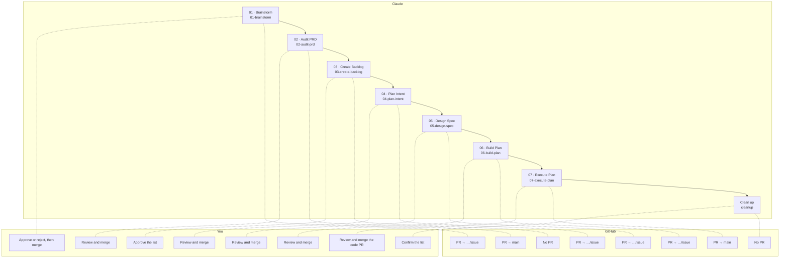
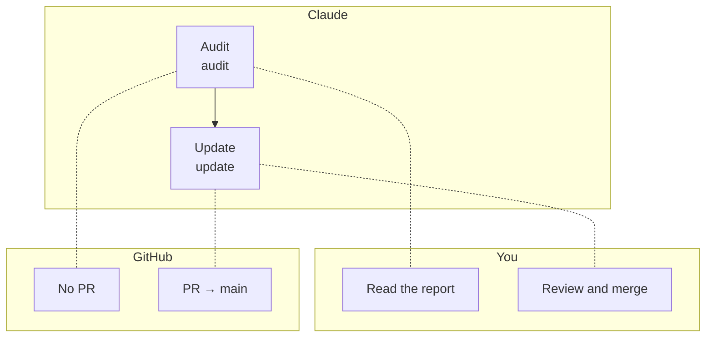

# Cuevik Plugins — Walkthrough

**Plugins:** cuevik-start 0.4.0, cuevik-ship 0.4.0, cuevik-docs 0.4.0, cuevik-deck 0.4.0  ·  **Marketplace:** cuevik-plugins  ·  **Author:** Viral Parikh

Claude drafts each step, you approve it. This guide covers all four plugins: how to install them, how every step works, and what each command does, from an empty repo to a merged code PR.

---

## 1. What you get

Three plugins with one rule: every document and change reaches `main` through a reviewed PR, and the next step will not run until the previous PR is merged.

| Plugin | Use it to | Commands |
|---|---|---|
| `cuevik-start` | Start a project the governed way | `00`–`09`, `express`, `migrate`, `status`, `cleanup` |
| `cuevik-ship` | Deliver one issue at a time, from idea to code PR | `01`–`07`, `cleanup` |
| `cuevik-docs` | Audit and update source-of-truth documents | `audit`, `update` |
| `cuevik-deck` | Turn a Statement of Work into a project kickoff deck | `kickoff-meeting` |

Each command carries a tag. **Available** means you can install and run it today. **Planned** means it is described here from the design and is not installable yet. The tags are generated from the plugins, so they change as commands are built.

---

## 2. Install and prerequisites

Before you install:

- [GitHub CLI](https://cli.github.com) (`gh`), signed in: `gh auth login`. To use a project board, also add the `project` scope: `gh auth refresh -s project`.
- A local Claude Code session. Cloud sessions cannot reach GitHub Projects, so a cloud session sets up no board.
- Read access to the marketplace repository, which is private for now.
- Admin rights on the project's repo. `00-bootstrap` changes a repo setting, and links a board when there is one.
- GitHub as your host. It is the only one supported.

Install, in Claude Code:

```text
/plugin marketplace add anthropics/claude-plugins-official
/plugin marketplace add viralparikh-dev/cuevik-plugins
/plugin install cuevik-start@cuevik-plugins
/plugin install cuevik-ship@cuevik-plugins
```

`cuevik-docs` installs automatically: both other plugins depend on it. `cuevik-start` also installs `superpowers` from the official Claude marketplace (`claude-plugins-official`): `01-product-concept` uses its brainstorming skill for the interview, and refuses to run without it. Add the official marketplace first (the first line above): without it `superpowers` cannot install and `cuevik-start` does not load. Skip that line if `/plugin marketplace list` already shows `claude-plugins-official`.

Run commands in your project folder (the repo root), in a new Claude Code session. Steps run only when you type them; Claude never starts one on its own.

---

## 3. How it works

- **One step, one session.** Run one step per session. Ask for a second step in the same session and it tells you to start a new one. The one exception is `express`, which does the work of four steps in one session.
- **One PR per step.** A step works on its own branch (`init/<name>` in `cuevik-start`), commits there, and opens a PR to `main` once you approve. It never commits to `main`.
- **Merged means final.** A document counts only when its PR is merged. The next step refuses to run until the previous PR is merged. An open PR does not count.
- **Nothing happens without a yes.** Before it creates a branch, writes files, files issues or pushes, a step shows a checklist of what it verified and waits for your explicit `yes`.
- **One question at a time, fixed structure.** Claude interviews you for each section with pick-or-type questions, offers only drafts it can trace to an earlier document or answer, never assumes an answer, and fills a template, so every project gets the same sections in the same order, with no placeholders left.
- **Owners and reviewers.** Every document has an owner role and reviewer roles. Claude acts as the owner while it drafts, and each reviewer applies their own checklist at PR review. These are roles, not GitHub accounts.
- **Solo is fine.** GitHub does not let you approve your own PR, so when one person holds every role, the self-review checklist in `CONTRIBUTING.md` is the approval. Wait a few hours (ideally a day), check every required section is covered and no upstream document changed on `main`, then merge. Change hats on purpose.
- **Finished means finished.** Re-running a finished step stops and sends you to `/cuevik-docs:update <document>`.

### What happens inside a step

1. You start the command in a fresh session, in the project folder.
2. It checks the ground: clean working tree, `main` up to date, the previous step's PR merged, upstream documents on `main`, and this step's output not already final.
3. It shows the checklist, waits for your `yes`, then creates the step's branch from `main`.
4. It interviews you, drafts, and revises until you approve, then commits on the branch.
5. On your approval it pushes and opens the PR, with a summary and the reviewer checklist.
6. You review and merge on GitHub, then start the next step in a new session.

---

## 4. The flow by actor

Who acts at each step, one diagram per plugin. They are also the three pages of `Cuevik-Plugins_WalkthroughByActor.pdf`.

### cuevik-start

Lanes are the document owners from the project's lineage. Every command is `/cuevik-start:<name>`.

<!-- gen:flow-start -->



<!-- /gen:flow-start -->

### cuevik-ship

You approve and merge, Claude runs each command in its own session, and GitHub holds the issue, branches and PRs. Every command is `/cuevik-ship:<name>`.

<!-- gen:flow-ship -->



<!-- /gen:flow-ship -->

### cuevik-docs

Same lanes as `cuevik-ship`. Every command is `/cuevik-docs:<name>`.

<!-- gen:flow-docs -->



<!-- /gen:flow-docs -->

---

## 5. cuevik-start: set up a project

Ten steps, run in order, one session and one PR each. Each step reads the documents before it from `main`, so the order matters. Every command is `/cuevik-start:<name>` and runs on branch `init/<name>`. The line under each heading is generated from the plugin's own step registry and lineage. For an MVP or spike, `express` does the work of four of them in one session and one PR; it is described last in this section.

Two small files describe the project to the plugins; `00-bootstrap` writes and commits both. `.cuevik/config.json` records whether the project has a board and, if so, its ids, so steps can add issues and move cards. `.cuevik/lineage.json` holds who owns and reviews each document and what it is built from. Everything else is your documents: the plugins never copy their own files into your repo.

### 00-bootstrap

<!-- gen:step-00-bootstrap -->

**Status:** Available  ·  **Owner:** Architect  ·  **Reviewers:** Architect  ·  **Reads:** —  ·  **Writes:** `CONTRIBUTING.md`, `.cuevik/config.json`, `.cuevik/lineage.json`, `.markdownlint.json`, `.github/workflows/cuevik-init-order.yml`  ·  **Then:** `/cuevik-start:01-product-concept`

<!-- /gen:step-00-bootstrap -->

Connects or creates the GitHub repo and, if you want one, a project board, then lands the governance baseline. Run it first, in the project folder. It is the only step that creates things outside your repo, so it shows its checks, lists every change with its commands, and asks once to make them all.

- **Repo.** Connects the folder to a GitHub repo, or creates one. It asks for the owner and name, and for the visibility of a new repo (private is suggested). In an empty folder it clones an existing repo. It stops if the folder has files but no repo (it never commits your files for you), if the folder sits inside another repo, or if `origin` is not on GitHub.
- **Board (optional).** Asks who owns the project board (the repo's owner by default), lists that owner's open boards, and lets you pick one, create a new one, or use no board. A new board starts from one of three choices: the Cuevik template (recommended), your own template (pick one of your boards or paste its link), or a blank board. If the template cannot be read, it asks again. A blank board gets only GitHub's default Status options (`Todo`, `In Progress`, `Done`). The board needs a single-select field named `Status`; without one it is not used. If bootstrap cannot reach Projects (no `project` scope, or a cloud session) it goes on without a board. A board problem never stops bootstrap: the result is recorded in `.cuevik/config.json` as `configured`, `partial` (with what is missing) or `none`, and reported in the PR.
- **Remote changes.** Approved together with one yes: create the board and link it to the repo (when you chose a board), turn on auto-delete for merged PR branches, so GitHub removes each PR's branch when it merges, and file the initiation issues. Then, when there is a board, it checks its seven workflows are on and walks you through turning on any that are off (GitHub offers no way to do this for you), including `Auto-add to project` with this repo in its filter. You may skip them; the board is then recorded as `partial`.
- **Initiation issues.** An `Epic: Project Initiation` epic and one story per later step, such as `INIT-01: Product Concept`, labelled `initiation`, assigned to you, linked as sub-issues of the epic. With a board they are also added to it, with Item Type (Epic or Story), Priority, Size and Efforts (hours) set when the board has those fields; on a board with no sprints yet, `Sprint-00` is created and they all go in it. Each step's PR closes its story when it merges, and the last step closes the epic, so the board shows how far setup has got. They never carry the `epic` or `story` labels, so the real backlog never picks them up.
- **The PR.** Opens `init/00-bootstrap` with `CONTRIBUTING.md`, `.cuevik/config.json`, `.cuevik/lineage.json` and `.markdownlint.json`. An existing `.markdownlint.json` is kept. An existing `CONTRIBUTING.md` keeps its text: the governance text is inserted after its first heading and you see the diff first. If the repo has no commit yet, it first makes one empty commit, `chore: initialize repository`, on `main` and pushes it. That is the only commit bootstrap makes on `main`.
- **The governance text** covers the review flow, Conventional Commits and the rule never to push to `main`. It also carries the initiation-only branching table and the self-review checklist, which `09-finalize` removes.
- **It stops, and says what to fix,** if `gh` is not signed in, the default branch is not `main`, you lack admin rights on the repo, the repo is already bootstrapped, or a `00-bootstrap` PR is already open.

Review the PR:

- `CONTRIBUTING.md` holds the governance text verbatim, with both `INITIATION-ONLY` markers. If it already existed, your text is unchanged.
- No stack-specific commands in `CONTRIBUTING.md`.
- `.cuevik/config.json` says whether the repo has a board (`boardState`), names it with ids read from GitHub when it does, and holds the initiation issue numbers.
- `.cuevik/lineage.json` matches the plugin's default lineage.
- Auto-delete is on: `gh repo view --json deleteBranchOnMerge` returns `true`.
- No plugin files (runner, registry, templates, roles) in the diff.

Not yet tested: linking a user-owned board to an organisation-owned repo.

### 01-product-concept

<!-- gen:step-01-product-concept -->

**Status:** Available  ·  **Owner:** Product Owner  ·  **Reviewers:** Product Owner  ·  **Reads:** —  ·  **Writes:** `docs/PRODUCT.md`  ·  **Then:** `/cuevik-start:02-product-requirements`

<!-- /gen:step-01-product-concept -->

Defines what the product is, who it is for and why it exists. Claude interviews you as the Product Owner with the `superpowers` brainstorming skill: one open question at a time, anchored in real moments, with a short playback of what it heard after each part for you to correct. It pushes back: every feature must answer *what user problem does this solve?*, and nothing technical belongs here. The result is `docs/PRODUCT.md` with seven sections: Overview, Target Users (including Stakeholders), Features, Scope (In / Out), Success Criteria, Key Assumptions & Validation, Anti-Patterns. You can paste a one-paragraph pitch first: Claude drafts a strawman where every statement traces to your pitch, then interviews you over it.

### 02-product-requirements

<!-- gen:step-02-product-requirements -->

**Status:** Available  ·  **Owner:** Product Owner  ·  **Reviewers:** Product Owner  ·  **Reads:** `docs/PRODUCT.md`  ·  **Writes:** `docs/PRD.md`  ·  **Then:** `/cuevik-start:03-architecture`

<!-- /gen:step-02-product-requirements -->

Turns the concept into numbered, testable requirements. Claude brainstorms each section with you as the Product Owner, one at a time: it drafts Overview to Features from `docs/PRODUCT.md`, then asks what is missing; for each capability it asks first, may offer labelled possible behaviours to pick from, attacks the drafted requirements (failures, limits, invalid input), and only then asks you to approve. Every number comes from you. The result is `docs/PRD.md` with twelve sections: Overview, Target Users, Problem Statements, Features / Capabilities, User Stories, Functional Requirements, Non-Functional Requirements, Acceptance Criteria, Out of Scope (This Release), Dependencies & Assumptions, Constraints (Non-Architectural), Risks & Edge Cases.

The Product Owner blocks the PR if:

- acceptance criteria are vague ("works correctly", "performs well")
- a feature has no user story
- a requirement does not trace back to `docs/PRODUCT.md`
- implementation, architecture or stack details appear
- out-of-scope items are implied instead of listed
- requirements lack unique IDs

### 03-architecture

<!-- gen:step-03-architecture -->

**Status:** Available  ·  **Owner:** Architect  ·  **Reviewers:** Architect, Product Owner  ·  **Reads:** `docs/PRD.md`  ·  **Writes:** `docs/ARCHITECTURE.md`  ·  **Then:** `/cuevik-start:04-tech-stack`

<!-- /gen:step-03-architecture -->

Designs the system from the requirements. Claude works through it with you as the Architect, one section at a time: it asks first, may offer two or three labelled possible designs with their trade-offs to pick from, attacks each draft (a failing component, load at the PRD's targets, a breach), and only then asks you to approve. Every number comes from the PRD or from you, and product names go to the next step. The result is `docs/ARCHITECTURE.md` with eight sections: System Architecture, Data Design, Data Flow & Interactions, Key Design Decisions, Implementation Conventions, Integration Points, Security Posture & Data Classification, Non-Functional Approach.

Every significant decision is written as **Context, Decision, Alternatives rejected, Trade-offs**. The Product Owner co-reviews the scope only. If the architecture contradicts or widens the scope in the PRD, they block the PR with a written scope conflict. Resolving it takes a PRD update through its own PR first, then the architecture is revised.

### 04-tech-stack

<!-- gen:step-04-tech-stack -->

**Status:** Available  ·  **Owner:** Architect  ·  **Reviewers:** Architect  ·  **Reads:** `docs/PRD.md`, `docs/ARCHITECTURE.md`  ·  **Writes:** `docs/TECH-STACK.md`, `CONTRIBUTING.md`  ·  **Then:** `/cuevik-start:05-test-strategy`

<!-- /gen:step-04-tech-stack -->

Locks the approved technologies and the trade-offs behind them. Claude starts from the products named during the architecture step, offers labelled candidates with their trade-offs for each open choice, and takes every version from you or from the technology's own release page, never from memory. The result is `docs/TECH-STACK.md` with six sections: Languages & Frameworks, Datastores, Cloud & Infrastructure Services, Key Libraries / Tools, Selection Trade-offs, Versions & Constraints.

It then appends a tooling layer (versions; install, run, test, lint and build commands; hooks) to the end of `CONTRIBUTING.md` between `TOOLING-LAYER` markers, writing `Not set yet` for any command not known before the code exists, using only technologies approved in `TECH-STACK.md` and leaving the governance layer from `00-bootstrap` untouched. The Architect blocks the PR if a technology choice has no justification against the alternatives.

### 05-test-strategy

<!-- gen:step-05-test-strategy -->

**Status:** Available  ·  **Owner:** Architect  ·  **Reviewers:** Architect, Product Owner  ·  **Reads:** `docs/PRD.md`, `docs/ARCHITECTURE.md`, `docs/TECH-STACK.md`  ·  **Writes:** `docs/TEST-STRATEGY.md`  ·  **Then:** `/cuevik-start:06-ai-tool-guide`

<!-- /gen:step-05-test-strategy -->

Sets how the product will be verified. Claude reads the PRD, the architecture and the tech stack, summarizes what needs verifying, and interviews the Architect one section at a time. The result is `docs/TEST-STRATEGY.md` with six sections: Test Levels, Coverage Target, Test Environment & Data, NFR Verification, Quality Ownership, Defect Management.

Every number, the coverage target above all, comes from you: with no coverage target the step cannot finish. NFR pass thresholds are copied from the PRD, never invented, and no test tool is named that `TECH-STACK.md` does not list. The Architect owns it and the Product Owner co-reviews, checking that every Must requirement maps to a test level. The AI tool guide, the README and the backlog are built after it and can refer to it.

### 06-ai-tool-guide

<!-- gen:step-06-ai-tool-guide -->

**Status:** Available  ·  **Owner:** Architect  ·  **Reviewers:** Architect  ·  **Reads:** `docs/ARCHITECTURE.md`, `docs/TECH-STACK.md`, `docs/TEST-STRATEGY.md`  ·  **Writes:** `docs/AI-TOOL-GUIDE.md`, `CLAUDE.md`, `.github/copilot-instructions.md`, `.claude/settings.json`  ·  **Then:** `/cuevik-start:07-readme`

<!-- /gen:step-06-ai-tool-guide -->

Sets the rules AI coding assistants follow on this project. It asks which AI tools the team uses, then writes `docs/AI-TOOL-GUIDE.md` and only the adapter files for those tools (`CLAUDE.md`, `.github/copilot-instructions.md`). The shared rules live in the guide; each adapter points to it and holds only tool-specific settings. If the team uses Claude Code, it also writes `.claude/settings.json` with the plugins you pick for the team (for example `superpowers` and `code-review`), so everyone who opens the repo is offered the same ones. Tools that are not plugins, such as graphify, are listed in the guide as a manual prerequisite.

The guide has ten sections: Project Context, Coding Conventions, Scope Boundaries, Banned Patterns, Testing Rules, Documentation Rules, Decision Escalation, Agent Behavior Rules, Off-Limits Boundaries, Workflow Conventions. The Testing Rules are consistent with the levels and coverage target in `TEST-STRATEGY.md`.

### 07-readme

<!-- gen:step-07-readme -->

**Status:** Available  ·  **Owner:** Architect  ·  **Reviewers:** Architect  ·  **Reads:** `docs/PRODUCT.md`, `docs/PRD.md`, `docs/ARCHITECTURE.md`, `docs/TECH-STACK.md`, `docs/TEST-STRATEGY.md`, `docs/AI-TOOL-GUIDE.md`  ·  **Writes:** `README.md`  ·  **Then:** `/cuevik-start:08-backlog`

<!-- /gen:step-07-readme -->

Replaces the repo's boilerplate README with the project's real entry point, built from the documents before it: Project Overview, Key Concepts, Prerequisites, Environment Setup, Install & Run, Run Tests, Project Structure, Further Reading. Leftover placeholder text is removed. If application code already exists, every command in the README is run before it is committed; if not (docs-first), Environment Setup is written as the intended setup and marked pending and unverified until the app is scaffolded, while prerequisites, install and test show pointers to `TECH-STACK.md` and `CONTRIBUTING.md` instead of copied versions or commands. You confirm which mode applies.

### 08-backlog

<!-- gen:step-08-backlog -->

**Status:** Available  ·  **Owner:** Product Owner  ·  **Reviewers:** Product Owner  ·  **Reads:** `docs/PRODUCT.md`, `docs/PRD.md`, `docs/ARCHITECTURE.md`, `docs/TECH-STACK.md`, `docs/TEST-STRATEGY.md`, `docs/AI-TOOL-GUIDE.md`, `README.md`  ·  **Writes:** `docs/BACKLOG.md`  ·  **Then:** `/cuevik-start:09-finalize`

<!-- /gen:step-08-backlog -->

Derives epics and stories from the PRD (one epic per capability section, one story per requirement, titled `PRD-NNN: <Title> (<Priority>)`), asks you for the priority of each non-functional requirement, shows them, and writes nothing until you approve. It then creates the GitHub issues one at a time, labelled `epic`, `story` and `priority:*`, links each story to its epic as a sub-issue, adds them to the board when the repo has one, and records the initial backlog in `docs/BACKLOG.md`: Summary, Epics, Stories, Out-of-Scope Notes.

After setup, GitHub is the backlog. `docs/BACKLOG.md` is a frozen point-in-time snapshot and the issues are authoritative. Issues are always filed. If the repo has no board you can pause to set one up (a PR on `.cuevik/config.json`) and re-run, which reuses the issues already filed, or continue without one.

### 09-finalize

<!-- gen:step-09-finalize -->

**Status:** Available  ·  **Owner:** Architect  ·  **Reviewers:** Architect  ·  **Reads:** `docs/TECH-STACK.md`  ·  **Writes:** `CONTRIBUTING.md`  ·  **Then:** `/cuevik-start:cleanup`

<!-- /gen:step-09-finalize -->

Ends initiation. It reads `CONTRIBUTING.md` from `main`, removes the fenced `INITIATION-ONLY` block (the branching table and the self-review checklist), keeps the permanent governance and the tooling layer exactly as they are, and puts a short development-phase stub where the block was. It does not write a full development policy: the team expands the stub later with `/cuevik-docs:update`. If the markers are missing it stops rather than guess which lines to delete. Its PR also closes the initiation epic.

Before the PR opens it runs `cuevik-docs:audit` read-only over the document set and puts the findings in the PR body. This is advice, never a gate; fix findings afterwards with `/cuevik-docs:update`.

Initiation is complete when this PR is merged.

### status

<!-- gen:cmd-cuevik-start-status -->

**Status:** Available  ·  **Branch:** none  ·  **PR to:** none  ·  **Writes:** Nothing (report only)  ·  **You:** Read the report

<!-- /gen:cmd-cuevik-start-status -->

Read-only. It shows how far setup has got from what is merged on GitHub, and writes nothing. Every step also runs it at the start of its session. When a step starts, its story on the board (if the repo has one) moves to Working with today's start date, and the previous story gets the date its PR merged as its end date.

It starts with a progress line, one cell per step, such as `██░░░░░░░░ 2/10 · next: 02-product-requirements`, then a row per step. The merged PR decides each row. If an initiation issue disagrees, for example a story closed with no merged PR, it adds a line saying so but does not change the row. For a repo with no board, or an incomplete one, it adds a `Board:` line saying so and how to add or repair it. If `.cuevik/config.json` is older than the current contract, it adds a line telling you to run `/cuevik-start:migrate`. For a repo set up with `express`, the four steps it covered show as merged by the Express PR.

### cleanup

<!-- gen:cmd-cuevik-start-cleanup -->

**Status:** Available  ·  **Branch:** none  ·  **PR to:** none  ·  **Writes:** Deletes merged local `init/*` branches  ·  **You:** Confirm the list

<!-- /gen:cmd-cuevik-start-cleanup -->

Deletes the local `init/*` branches whose PR is merged. It skips and reports any that are not merged, or that have local commits the PR never got, and lists what it will delete and asks first. Once `09-finalize` is merged it also records the End date of the last story and of the initiation epic on the board, if the repo has one. Run it any time, typically after `09-finalize` merges. GitHub has already deleted the remote branches.

### express

<!-- gen:cmd-cuevik-start-express -->

**Status:** Available  ·  **Branch:** `init/express`  ·  **PR to:** `main`  ·  **Writes:** Governance files, `PRODUCT.md`, `PRD.md`, `BACKLOG.md`, issues  ·  **You:** Interviews, approve, review and merge

<!-- /gen:cmd-cuevik-start-express -->

The lean path for an MVP or spike. Run it instead of the ten steps, in the project folder of a repo that is not bootstrapped yet. In one session and one PR, from branch `init/express`, it does the work of `00`, `01`, `02` and `08`:

- **A pitch, if you have one.** It asks first for an optional one-paragraph pitch. With one, `01` drafts a strawman in which every statement traces to the pitch; without, it interviews you as usual.
- **Bootstrap without a board.** The repo, `CONTRIBUTING.md` (the permanent rules plus a short initiation block that holds only the self-review checklist), `.cuevik/config.json` (`boardState` `none`, `backlogModel` `flat`), the default `.cuevik/lineage.json`, `.markdownlint.json`, and the initiation issues: one story per step `01` to `09`, each a `Task` where the org has issue types, and **no epic**.
- **A lean `PRODUCT.md` and `PRD.md`.** `PRODUCT.md` fills Overview, Target Users, Features, Scope and Success Criteria. `PRD.md` fills Overview, Features / Capabilities, Functional Requirements, Acceptance Criteria and Out of Scope. Every other heading stays, with one line saying it is not covered in the Express lane. The writing rules are the same as in the full steps.
- **The backlog.** `08` files the stories as `Feature`s (where the org has issue types) and writes `docs/BACKLOG.md`, with no epics filed as issues — they stay as logical rows in `BACKLOG.md` — and no question about a board.
- **What it skips.** `03` to `07` and `09`: no `ARCHITECTURE.md`, `TECH-STACK.md`, `TEST-STRATEGY.md`, `AI-TOOL-GUIDE.md` or `README.md`.

The PR has four commits (bootstrap, `PRODUCT.md`, `PRD.md`, `BACKLOG.md`) and both roles review it: the Architect for the governance files, the Product Owner for the three documents. It closes the stories for `01`, `02` and `08`; the other stories stay open (there is no epic).

To graduate later, run `/cuevik-start:03-architecture` and the steps after it as usual. The merged Express PR counts as the PR of the steps it covered, and `/cuevik-docs:update` deepens the lean documents.

### migrate

<!-- gen:cmd-cuevik-start-migrate -->

**Status:** Available  ·  **Branch:** `init/migrate`  ·  **PR to:** `main`  ·  **Writes:** The two `.cuevik/` files  ·  **You:** Approve, review and merge

<!-- /gen:cmd-cuevik-start-migrate -->

Brings an older repo up to date. Run it when a step or `cuevik-ship` stops with `.cuevik/config.json is schemaVersion <n>`. It reads `.cuevik/config.json` and `.cuevik/lineage.json` from `main` and, after showing the exact edits and getting your yes, opens one PR from `init/migrate` that sets the config to version 4 (adding `boardState` to a version 2 config), renames the stories' keys to the current step ids, renames the step ids in the lineage, and adds the `docs/TEST-STRATEGY.md` entry with its upstream links.

Nothing else changes: no issue is filed, `CONTRIBUTING.md` is not touched (its initiation-only table keeps the old ids until `09-finalize`), and it never merges. A repo that is already current gets `Nothing to migrate.` Merge the PR, then re-run the step you wanted. A migrated repo has no initiation story for `05-test-strategy`, so `status` lists that step as not started until you run it.

To revise a document after its step is merged, use `/cuevik-docs:update <document>` instead of re-running the step.

---

## 6. cuevik-ship: deliver one issue at a time

Takes one idea, or one existing issue, from brainstorm to a merged code PR: seven steps and a cleanup, one session and one PR each. Run it in a project that has been through `00-bootstrap`, because it reads `.cuevik/config.json`, including the board's ids when the repo has a board. Every command is `/cuevik-ship:<name>`. `<n>` is the issue number and `<slug>` its short name. The line under each heading is generated from the branches-and-files table in section 9.

### How it differs from cuevik-start

- **One issue at a time.** Each issue gets its own git worktree, so several issues can be in flight at once. Where worktrees live is a setting on your machine, not committed to the project.
- **One rule.** Files under `docs/ship/<n>-<slug>/` go to the issue's own branch, `ship/<n>-<slug>/issue`. Everything else goes to `main`. `docs/ship/` never reaches `main`.
- **The issue branch** holds only that folder and is never merged. `01-brainstorm` creates it, or `04-plan-intent` does for an issue that has none, such as a bug fix or a split story.
- **Where each step goes.** Steps 01, 04, 05 and 06 work on a branch under `ship/<n>-<slug>/` and their PRs go back into the issue branch. Steps 02 and 07 are cut from `main` and their PRs go to `main`. Step 03 writes to GitHub only: no branch, no PR.
- **Merged means final,** as in `cuevik-start`: each step checks that the previous step's PR is merged before it does anything.
- **References.** The issue description carries a `## References` section between `<!-- cuevik-ship:references -->` markers: links to the issue's files, never file content. Every command refreshes it, so do not edit between the markers.
- **Labels only.** `idea`, `epic`, `story` and `priority:*`. GitHub issue types are not used, because user-owned repos do not have them.

### 01-brainstorm

<!-- gen:cmd-cuevik-ship-01-brainstorm -->

**Status:** Available  ·  **Branch:** `ship/<n>-<slug>/01-brainstorm`  ·  **PR to:** `ship/<n>-<slug>/issue`  ·  **Writes:** GitHub issue and brainstorming folder  ·  **You:** Approve or reject, then merge

<!-- /gen:cmd-cuevik-ship-01-brainstorm -->

Takes an idea or an existing issue number.

- **Duplicates first.** Before it asks anything, it checks existing `idea` issues in any state, and stories, so a duplicate never gets a number.
- **Issue at the start.** For a new idea it asks for 2–3 sentences, files a GitHub issue labelled `idea` straight away, then creates the issue branch, the worktree and the brainstorming folder, so findings are saved from the first minute.
- **The folder.** `docs/ship/<n>-<slug>/brainstorming/` holds `brainstorm.md`, plus attachments and any other files found along the way.
- **An existing issue.** It refuses an epic, sends a bug to `04-plan-intent`, and accepts an existing story (step 03 then treats it as changed). It never closes a story that already existed.
- **The outcome** is the PR into the issue branch. If you reject the idea, that PR is the record, and the issue is closed as *not planned* once you say yes. An abandoned idea is closed the same way and cleaned up like a rejection.
- **The board.** If the repo has a board, an idea may land on it, and its card carries through when the idea becomes a story.

### 02-audit-prd

<!-- gen:cmd-cuevik-ship-02-audit-prd -->

**Status:** Available  ·  **Branch:** `ship/<n>-<slug>/02-audit-prd` (cut from `main`)  ·  **PR to:** `main`  ·  **Writes:** `PRODUCT.md` and `PRD.md` changes  ·  **You:** Review and merge

<!-- /gen:cmd-cuevik-ship-02-audit-prd -->

Checks the approved idea against `docs/PRODUCT.md` and `docs/PRD.md`, and ratifies it into new or changed requirements. It uses `/cuevik-docs:audit` for the check.

- **Cut from `main`,** not from the issue branch, and its PR goes to `main`. `PRODUCT.md` and `PRD.md` are shared by every issue, and requirement numbers (`PRD-NNN`) must be allocated in one place. Cutting from `main` also means no `docs/ship/` file can leak into the PR.
- **`Refs #n`, never `Closes`.** Merging this PR must not close the issue; steps 04–07 still need it.
- **The ratification record** is a machine-readable block in this PR's body, plus a `Docs PR:` line in the issue's References. The brainstorm file keeps only step 01's decision.
- **Rejection here** is a comment on the issue and closing it, with no PR.

### 03-create-backlog

<!-- gen:cmd-cuevik-ship-03-create-backlog -->

**Status:** Available  ·  **Branch:** none  ·  **PR to:** none  ·  **Writes:** GitHub issues: epic and stories  ·  **You:** Approve the list

<!-- /gen:cmd-cuevik-ship-03-create-backlog -->

Turns the ratified requirements into GitHub issues. It writes to GitHub only; it does not write `docs/BACKLOG.md`, which is what `/cuevik-start:08-backlog` does once at setup.

- **The idea becomes a story.** Its title becomes `PRD-NNN: <Title> (<Priority>)` and the `idea` label is removed. Epics and stories share the labels `epic`, `story` and `priority:*` with `cuevik-start`.
- **Finding the epic.** In order: the parent of existing stories in the same PRD section, then an `epic` issue citing that section, then `docs/BACKLOG.md`, then a new epic. If several candidates fit it asks, and it never moves a story to another parent without your yes.
- **Splitting.** An idea that covers several requirements becomes several stories. The original issue keeps the first ID in prerequisite order, and you can change that in the approval table. Each extra story goes under its own PRD section's epic and starts its own branch set at `04-plan-intent`, linking back to the original's brainstorming.
- **The board.** If the repo has a board, issues are added to it only from a local session.
- **The gate for step 04.** Step 04 checks that the References have an `Epic:` line and that the issue no longer has the `idea` label.

### 04-plan-intent

<!-- gen:cmd-cuevik-ship-04-plan-intent -->

**Status:** Available  ·  **Branch:** `ship/<n>-<slug>/04-plan-intent`  ·  **PR to:** `ship/<n>-<slug>/issue`  ·  **Writes:** `intent.md` in the work folder  ·  **You:** Review and merge

<!-- /gen:cmd-cuevik-ship-04-plan-intent -->

States the problem and scope before any solution is proposed, in `intent.md` in the issue's work folder. It creates the issue branch and worktree when the issue has none: a bug fix or refactor starts here, and so does each extra story from a split.

### 05-design-spec

<!-- gen:cmd-cuevik-ship-05-design-spec -->

**Status:** Available  ·  **Branch:** `ship/<n>-<slug>/05-design-spec`  ·  **PR to:** `ship/<n>-<slug>/issue`  ·  **Writes:** `spec.md` in the work folder  ·  **You:** Review and merge

<!-- /gen:cmd-cuevik-ship-05-design-spec -->

Writes `spec.md` in the work folder: behaviour, data, rules and tests. When the project has a `docs/TEST-STRATEGY.md`, the tests follow its levels, its NFR verification methods and its coverage target; without one the step says so and carries on. If a later step changes an earlier file, the issue's References are refreshed.

### 06-build-plan

<!-- gen:cmd-cuevik-ship-06-build-plan -->

**Status:** Available  ·  **Branch:** `ship/<n>-<slug>/06-build-plan`  ·  **PR to:** `ship/<n>-<slug>/issue`  ·  **Writes:** `plan.md` in the work folder  ·  **You:** Review and merge

<!-- /gen:cmd-cuevik-ship-06-build-plan -->

Turns the spec into `plan.md`: a dependency-ordered task list that a fresh session can execute.

### 07-execute-plan

<!-- gen:cmd-cuevik-ship-07-execute-plan -->

**Status:** Available  ·  **Branch:** `ship/<n>-<slug>/07-execute-plan` (cut from `main`)  ·  **PR to:** `main`  ·  **Writes:** The code  ·  **You:** Review and merge the code PR

<!-- /gen:cmd-cuevik-ship-07-execute-plan -->

Builds the plan on a code branch cut from `main`, reading `plan.md` from the issue branch, and opens the code PR to `main`. That PR carries only the code, so no `docs/ship/` file reaches `main`. Its `Closes #n` is what closes the issue, and the final References refresh happens here.

### cleanup

<!-- gen:cmd-cuevik-ship-cleanup -->

**Status:** Available  ·  **Branch:** none  ·  **PR to:** none  ·  **Writes:** Worktree, local branches, archive tag  ·  **You:** Confirm the list

<!-- /gen:cmd-cuevik-ship-cleanup -->

`/cuevik-ship:cleanup <issue#>` removes everything local for an issue and keeps what the links need.

- **Gate:** the code PR is merged, or the issue was closed as *not planned*. There is no override flag, and it refuses while any `ship/<n>-*` PR is still open.
- **Removes** the issue's worktree (it refuses if there are uncommitted or unpushed changes) and the local `ship/<n>-<slug>/*` branches. Removing the worktree also removes the local `docs/ship/<n>-<slug>/` folder, since `main` never has it.
- **Archives** the remote issue branch as the tag `ship-archive/<n>-<slug>` and then deletes the branch. The tag keeps the commits reachable, so the links in the References keep working.
- **Does not close the issue.** The code PR does. A split story is cleaned up on its own, per issue.
- **Lists everything** it will delete and asks first. Run it from the main checkout, never from inside the worktree it removes.

---

## 7. cuevik-docs: keep the documents true

Two commands for the source-of-truth documents named in `.cuevik/lineage.json`. `cuevik-start` and `cuevik-ship` both depend on this plugin, so it installs with them. Every command is `/cuevik-docs:<name>`.

### audit

<!-- gen:cmd-cuevik-docs-audit -->

**Status:** Available  ·  **Branch:** none  ·  **PR to:** none  ·  **Writes:** A findings report  ·  **You:** Read the report

<!-- /gen:cmd-cuevik-docs-audit -->

Reads the project's documents once and runs three lenses over them:

- **Align.** Terms, goals, scope or acceptance criteria that do not cohere, and sections that are missing rather than wrong.
- **Drift.** Documents that contradict each other, the files on disk, or a decision already taken.
- **Absorb.** Two files that say the same thing twice, and which copy is better.

The lineage decides which documents are audited, and its upstream links decide which document wins a
disagreement. Each finding comes with where both sides say it, which one is right, the impact and
the exact fix. It changes nothing unless you add `fix`, which offers only the safe fixes (broken
links, stale dates, README transcription) as one PR. `/cuevik-ship:02-audit-prd` calls it.

### update

<!-- gen:cmd-cuevik-docs-update -->

**Status:** Available  ·  **Branch:** `docs/update/<doc>`  ·  **PR to:** `main`  ·  **Writes:** The document, via PR  ·  **You:** Review and merge

<!-- /gen:cmd-cuevik-docs-update -->

Revises one source-of-truth document after its step has merged. Use it any time reality diverges from a document, instead of re-running the step.

- The document's owner role drafts the change, and its reviewers (from the lineage) approve the PR.
- It then builds a downstream checklist: every document built from the one you changed. Review each flagged document, and do not mark the checklist complete until all of them are reviewed.
- Frozen documents, such as `docs/BACKLOG.md`, are skipped, and cannot be updated: GitHub
  issues are the backlog after initiation.
- The checklist lives in the PR body: each downstream document is marked as needing an update
  or only a review, with the reason.

What a change to each document flags, from the default lineage:

<!-- gen:downstream -->

| When you change | It flags for review |
|---|---|
| `CONTRIBUTING.md` | nothing |
| `docs/PRODUCT.md` | `CONTRIBUTING.md`, `docs/PRD.md`, `docs/ARCHITECTURE.md`, `docs/TECH-STACK.md`, `docs/TEST-STRATEGY.md`, `docs/AI-TOOL-GUIDE.md`, `README.md` |
| `docs/PRD.md` | `CONTRIBUTING.md`, `docs/ARCHITECTURE.md`, `docs/TECH-STACK.md`, `docs/TEST-STRATEGY.md`, `docs/AI-TOOL-GUIDE.md`, `README.md` |
| `docs/ARCHITECTURE.md` | `CONTRIBUTING.md`, `docs/TECH-STACK.md`, `docs/TEST-STRATEGY.md`, `docs/AI-TOOL-GUIDE.md`, `README.md` |
| `docs/TECH-STACK.md` | `CONTRIBUTING.md`, `docs/TEST-STRATEGY.md`, `docs/AI-TOOL-GUIDE.md`, `README.md` |
| `docs/TEST-STRATEGY.md` | `docs/AI-TOOL-GUIDE.md`, `README.md` |
| `docs/AI-TOOL-GUIDE.md` | `README.md` |
| `README.md` | nothing |
| `docs/BACKLOG.md` | nothing |

<!-- /gen:downstream -->

---

## 8. cuevik-deck: a kickoff deck from a Statement of Work

One command, standalone. Unlike the other plugins it needs no repository and opens no PR: it reads a Statement of Work, interviews you, and writes two files — a reviewed brief and a slide deck — to a folder you choose. Every command is `/cuevik-deck:<name>`.

### kickoff-meeting

<!-- gen:cmd-cuevik-deck-kickoff-meeting -->

**Status:** Available  ·  **Branch:** none  ·  **PR to:** none  ·  **Writes:** `KICKOFF-BRIEF.md` and the deck  ·  **You:** Answer the questionnaire, approve the brief

<!-- /gen:cmd-cuevik-deck-kickoff-meeting -->

Reads the SoW (a file or pasted text) and pulls out the engagement: objectives, deliverables, scope, timeline and commercial model. It then runs a structured questionnaire one section at a time, pre-filled from the SoW so you confirm or correct rather than answer from scratch: engagement and scope, technical landscape, agile ways of working, non-functional requirements (with measurable targets), governance and expectations, and risks. It assembles the answers into `KICKOFF-BRIEF.md` for your approval, then renders a client-ready deck — PowerPoint by default, or Google Slides or Claude Design Slides on request. Both files land in the folder you name; nothing is committed, and no number is invented for a requirement — an unanswered target is marked `[TBD]` to resolve before the kickoff.

---

## 9. Command reference

### What each command does

| Command | Title | What it does | Status |
|---|---|---|---|
| `/cuevik-start:00-bootstrap` | Bootstrap | Connects or creates the GitHub repo and, optionally, a project board, then lands the governance baseline in a reviewed PR. | Available |
| `/cuevik-start:01-product-concept` | Product Concept | Drafts the product concept with you: what it is, who it is for and why it exists. | Available |
| `/cuevik-start:02-product-requirements` | Requirements | Turns the concept into numbered, testable requirements (the PRD). | Available |
| `/cuevik-start:03-architecture` | Architecture | Designs the system: components, data, integrations and the decisions behind them. | Available |
| `/cuevik-start:04-tech-stack` | Tech Stack | Locks the approved technologies and the build, test and lint commands. | Available |
| `/cuevik-start:05-test-strategy` | Test Strategy | Sets the test levels, coverage target, environments, NFR verification, quality owners and defect handling. | Available |
| `/cuevik-start:06-ai-tool-guide` | AI Tool Guide | Sets the rules for AI coding assistants and generates the files each one reads. | Available |
| `/cuevik-start:07-readme` | README | Replaces the boilerplate README with the project's real entry point. | Available |
| `/cuevik-start:08-backlog` | Initial Backlog | Derives epics and stories from the product docs and files them as GitHub issues. | Available |
| `/cuevik-start:09-finalize` | Finalize Governance | Removes the initiation-only rules from CONTRIBUTING.md and hands over the permanent ones. | Available |
| `/cuevik-start:status` | Status | Shows how far initiation has got, from what is merged on GitHub. Read-only. | Available |
| `/cuevik-start:cleanup` | Clean up | Deletes local `init/*` branches whose PR is merged, after listing them for your confirmation. | Available |
| `/cuevik-start:express` | Express | The lean path for an MVP or spike: governance, a lean product concept and PRD, and the backlog, in one session and one PR. | Available |
| `/cuevik-start:migrate` | Migrate | Brings an older repo's `.cuevik/` files up to the current versions and step ids in one reviewed PR. | Available |
| `/cuevik-ship:01-brainstorm` | Brainstorm | Takes an idea or an existing issue, checks it is not a duplicate, and explores it until you can approve or reject it. | Available |
| `/cuevik-ship:02-audit-prd` | Audit PRD | Checks the approved idea against the product docs and ratifies it into new or changed requirements. | Available |
| `/cuevik-ship:03-create-backlog` | Create Backlog | Files the requirements as an epic and stories on GitHub, splitting the idea when it covers several. | Available |
| `/cuevik-ship:04-plan-intent` | Plan Intent | States the problem and scope, before any solution, in the issue's own work folder. | Available |
| `/cuevik-ship:05-design-spec` | Design Spec | Writes the spec: behaviour, data, rules and tests. | Available |
| `/cuevik-ship:06-build-plan` | Build Plan | Turns the spec into a dependency-ordered task list that a fresh session can execute. | Available |
| `/cuevik-ship:07-execute-plan` | Execute Plan | Builds the plan on a code branch and opens the code PR to `main`. | Available |
| `/cuevik-ship:cleanup` | Clean up | Removes the issue's worktree and local branches and archives the remote branch as a tag, after listing them for your confirmation. | Available |
| `/cuevik-docs:audit` | Audit | Reads your docs once and reports gaps (Align), contradictions (Drift) and duplication (Absorb). | Available |
| `/cuevik-docs:update` | Update | Updates one source-of-truth document through a reviewed PR, using its owner and reviewers from the lineage, and flags downstream documents. | Available |
| `/cuevik-deck:kickoff-meeting` | Kickoff Meeting | Turns a Statement of Work into a project kickoff deck via a discovery questionnaire and a reviewed brief. | Available |

### Branches and files (ship, docs and utility commands)

The ten numbered `cuevik-start` steps are not repeated here: see section 5. In `cuevik-ship`, `<n>` is the issue number and `<slug>` its short name.

| Command | Branch | PR to | Writes | You |
|---|---|---|---|---|
| `/cuevik-start:status` | — | — | Nothing (report only) | Read the report |
| `/cuevik-start:cleanup` | — | — | Deletes merged local `init/*` branches | Confirm the list |
| `/cuevik-start:express` | `init/express` | `main` | Governance files, `PRODUCT.md`, `PRD.md`, `BACKLOG.md`, issues | Interviews, approve, review and merge |
| `/cuevik-start:migrate` | `init/migrate` | `main` | The two `.cuevik/` files | Approve, review and merge |
| `/cuevik-ship:01-brainstorm` | `ship/<n>-<slug>/01-brainstorm` | `ship/<n>-<slug>/issue` | GitHub issue and brainstorming folder | Approve or reject, then merge |
| `/cuevik-ship:02-audit-prd` | `ship/<n>-<slug>/02-audit-prd` (cut from `main`) | `main` | `PRODUCT.md` and `PRD.md` changes | Review and merge |
| `/cuevik-ship:03-create-backlog` | — | — | GitHub issues: epic and stories | Approve the list |
| `/cuevik-ship:04-plan-intent` | `ship/<n>-<slug>/04-plan-intent` | `ship/<n>-<slug>/issue` | `intent.md` in the work folder | Review and merge |
| `/cuevik-ship:05-design-spec` | `ship/<n>-<slug>/05-design-spec` | `ship/<n>-<slug>/issue` | `spec.md` in the work folder | Review and merge |
| `/cuevik-ship:06-build-plan` | `ship/<n>-<slug>/06-build-plan` | `ship/<n>-<slug>/issue` | `plan.md` in the work folder | Review and merge |
| `/cuevik-ship:07-execute-plan` | `ship/<n>-<slug>/07-execute-plan` (cut from `main`) | `main` | The code | Review and merge the code PR |
| `/cuevik-ship:cleanup` | — | — | Worktree, local branches, archive tag | Confirm the list |
| `/cuevik-docs:audit` | — | — | A findings report | Read the report |
| `/cuevik-docs:update` | `docs/update/<doc>` | `main` | The document, via PR | Review and merge |
| `/cuevik-deck:kickoff-meeting` | — | — | `KICKOFF-BRIEF.md` and the deck | Answer the questionnaire, approve the brief |

---

## 10. Who owns which document

From the default lineage: who owns each document, who reviews a change to it, and what it is built from.

<!-- gen:doc-owners -->

| Document | Owner | Reviewers | Built from |
|---|---|---|---|
| `CONTRIBUTING.md` | Architect | Architect | `docs/TECH-STACK.md` |
| `docs/PRODUCT.md` | Product Owner | Product Owner | — |
| `docs/PRD.md` | Product Owner | Product Owner | `docs/PRODUCT.md` |
| `docs/ARCHITECTURE.md` | Architect | Architect, Product Owner | `docs/PRD.md` |
| `docs/TECH-STACK.md` | Architect | Architect | `docs/PRD.md`, `docs/ARCHITECTURE.md` |
| `docs/TEST-STRATEGY.md` | Architect | Architect, Product Owner | `docs/PRD.md`, `docs/ARCHITECTURE.md`, `docs/TECH-STACK.md` |
| `docs/AI-TOOL-GUIDE.md` | Architect | Architect | `docs/ARCHITECTURE.md`, `docs/TECH-STACK.md`, `docs/TEST-STRATEGY.md` |
| `README.md` | Architect | Architect | `docs/PRODUCT.md`, `docs/PRD.md`, `docs/ARCHITECTURE.md`, `docs/TECH-STACK.md`, `docs/TEST-STRATEGY.md`, `docs/AI-TOOL-GUIDE.md` |
| `docs/BACKLOG.md` | Product Owner | Product Owner | `docs/PRODUCT.md`, `docs/PRD.md`, `docs/ARCHITECTURE.md`, `docs/TECH-STACK.md`, `docs/TEST-STRATEGY.md`, `docs/AI-TOOL-GUIDE.md`, `README.md` |

<!-- /gen:doc-owners -->

---

## 11. Troubleshooting

A step stops with a message rather than guessing. Fix the cause and re-run it. `00-bootstrap` skips what it already did, so a re-run does not create anything twice.

| You see | Cause and fix |
|---|---|
| `gh is not signed in` | Run `gh auth login`, then re-run. |
| `gh cannot read Projects for <owner>` | Bootstrap goes on without a board and says so. To use a board, add the `project` scope in a local session (`gh auth refresh -s project`), then add the board later (see below). Cloud sessions cannot reach Projects. |
| `Uncommitted changes detected` | A step starts from a clean working tree. Commit or stash, then re-run. |
| `Could not fast-forward main` | Local `main` has diverged, or there is no network. Fix the pull error, then re-run. |
| Run `/cuevik-start:00-bootstrap` and merge its PR first | `.cuevik/config.json` or `.cuevik/lineage.json` is not on `main` yet. |
| The previous step's PR must be merged first | The message names the step. Merge that PR (an open PR does not count), then re-run. |
| A document is missing from `main` | An upstream document is not merged yet. Merge the step that writes it first. |
| The step is already complete | Its output is already final on `main`. Revise it with `/cuevik-docs:update`. |
| The step's branch already exists | A closed, unmerged PR leaves its branch behind. The step asks you to reuse it or delete it (after a `yes`); it never picks another name. |
| `This folder is inside the git repo at <path>` | Run from the project repo's root, or move the folder out of the parent repo. Never delete a `.git` folder yourself. |
| `This folder has files but is not a git repo` | Commit the files to a repo yourself, then re-run. Bootstrap never commits your files. |
| `origin points at <url>, which does not exist or you cannot access` | Fix or remove `origin`, then re-run. |
| `origin` is not on github.com | GitHub is the only supported host. |
| The default branch is not `main`, or you lack admin rights | Every step uses `main`. Bootstrap changes a repo setting (and links a board, if you use one), so it needs admin rights. |
| `This repo is already bootstrapped` | `.cuevik/` is already on `main`. To add or repair the board, open a PR that edits `.cuevik/config.json`: add `project` and set `boardState` (and `missing` for a partial board). |
| `.cuevik/config.json is schemaVersion <n>` | The config is older than the current contract (before the optional board, before the steps were renumbered, or before the backlog model was recorded). Run `/cuevik-start:migrate` and merge its PR. `cuevik-start` (from `01`) and `cuevik-ship` stop until then. |
| A `00-bootstrap`, Express or migration PR is already open | Merge it, or close it and delete its branch, then re-run. |
| The board needs a single-select field named `Status` | Add that field to the board, choose another board, or choose no board. |
| The template board cannot be read | Name another template, choose an existing board, or a blank one. A blank board gets only `Todo`, `In Progress` and `Done`. |
| Linking the board fails | Bootstrap shows GitHub's error and goes on, recording the board as `partial` (missing `link`). It does not retry with another owner. Fix the link yourself, then update `.cuevik/config.json`. |
| You asked for a second step in the same session | One step per session. Start a new session for the next step. |

---

## 12. Known limits

- **GitHub only,** and a local Claude Code session for anything that touches Projects. Cloud sessions cannot reach GitHub Projects.
- **Approval is process-enforced.** GitHub does not let you approve your own PR, so for solo work the self-review checklist is the gate. Nothing in GitHub enforces it.
- **Built, not yet run live:** `cuevik-start` steps `03` to `09`, `cleanup`, `express` and `migrate`, and every `cuevik-ship`, `cuevik-docs` and `cuevik-deck` command. Only `00` to `02` and `status` have been run end to end on a real repo, so expect fixes after first use.
- **Not yet tested:** linking a user-owned board to an organisation-owned repo, and copying another user's template board.
- **Board copies:** bootstrap reports differences between a template board and its copy, but cannot see the settings inside each workflow (for example which Status "Item closed" sets).
- **Not yet verified:** creating sub-issue and blocked-by links from a cloud session, which `/cuevik-ship:03-create-backlog` relies on.
- **Plugin settings:** in one sandbox test a plugin setting reached a skill unsubstituted, cause unknown, so bootstrap asks for the template board instead. `cuevik-ship`'s worktree-folder setting uses the same mechanism and is untested.
- **Labels, plus issue types in the Express lane.** The standard lane and `cuevik-ship` use labels only. The Express lane additionally gives its issues a native type (`Task` for `INIT-*`, `Feature` for `PRD-*`) when the repo's owner is an organisation that has issue types; a user-owned repo cannot, so it files them untyped.
- **`docs/BACKLOG.md` is a snapshot.** After setup, GitHub is the backlog.
- **Older repos need `/cuevik-start:migrate`.** A repo set up before the optional board, the test strategy step, or the backlog model was recorded has the old config version and step ids; `cuevik-start` (from `01`) and `cuevik-ship` stop on it until it is migrated. Merged PRs on the old step branches still count, through each step's alias.

---

## Version history

| Version | Date | Change |
|---|---|---|
| 0.4.0 | 2026-11-05 | `cuevik-start` 0.4.0: the Express lane files no epic issues and gives its issues a native type (`Task` for `INIT-*`, `Feature` for `PRD-*`) where the organisation has issue types; config contract version 5 adds `backlogModel` (`epic-grouped` for the standard lane, `flat` for Express) — run `/cuevik-start:migrate` on older repos. `cuevik-ship`, `cuevik-docs` and `cuevik-deck` move to 0.4.0 so all plugins share one version |
| 0.3.0 | 2026-11-05 | `cuevik-start`: new `05-test-strategy` step (the old `05` to `08` are now `06` to `09`), the `express` and `migrate` commands, an optional project board. Config contract version 4: run `/cuevik-start:migrate` on older repos. `cuevik-ship` and `cuevik-docs` follow the new contract; the ship design step uses the test strategy |
| 0.2.1 | 2026-10-28 | `cuevik-ship` 0.2.1: fixes `03-create-backlog` frontmatter that did not parse |
| 0.2.0 | 2026-10-28 | First release, covering `cuevik-start` 0.2.0, `cuevik-ship` 0.2.0 and `cuevik-docs` 0.2.0 |
